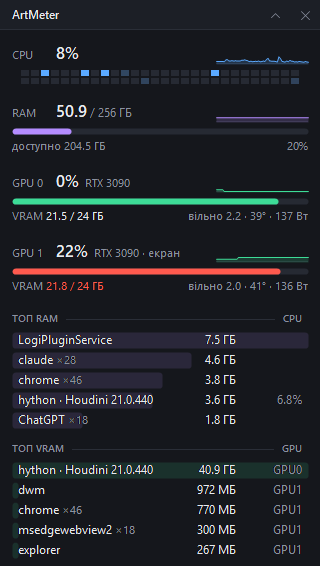
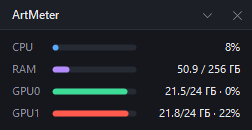

<p align="center"></p>

<h1 align="center">ArtMeter</h1>

<p align="center">Легкий монітор ресурсів для Windows: CPU, RAM і кожна відеокарта NVIDIA — завантаження, зайнята й вільна відеопам'ять, і які програми все це з'їли.</p>

<p align="center">
  
  &nbsp;&nbsp;
  
</p>

Невеликий віджет поверх усіх вікон. Зроблений для VFX-станції, де важливо бачити, скільки VRAM лишилося до того, як Houdini, Nuke чи рендер упреться в стелю. Один `.exe` на ~70 КБ, без установки й залежностей; сам бере ~12 мс CPU на секунду.

## Що показує

- **CPU** — загальне завантаження, сітка по кожному потоку й графік за останню хвилину.
- **RAM** — зайнято / всього, скільки доступно.
- **Кожна GPU** — завантаження, VRAM зайнято / всього, вільно, температура й споживання; позначка, до якої карти під'єднано екран.
- **Топ RAM** — програми, що з'їли найбільше пам'яті (однакові процеси згорнуті в один рядок з кількістю), і їхній CPU.
- **Топ VRAM** — хто зайняв відеопам'ять і на якій карті.
- Смуги пам'яті стають червоними від 90%: саме тоді починається свопінг або закінчується VRAM.

Іконка в треї — три стовпчики (CPU, RAM, VRAM), підказка при наведенні — короткі цифри.

## Встановлення

1. Завантаж `ArtMeter.exe` з [Releases](../../releases) (або збери сам, див. нижче).
2. Поклади в папку, куди є право запису, наприклад `C:\Tools\ArtMeter` — поруч з'являться `config.json` і `artmeter.log`.
3. Запусти. При першому запуску вмикається автозапуск із Windows; вимкнути — галочкою в меню.

Потрібні Windows 10/11 x64. Розділ GPU — для карт NVIDIA (дані через NVML — те саме джерело, що й у `nvidia-smi`).

## Керування

- Тягни віджет за будь-яке місце — він прилипає до країв екрана й запам'ятовує позицію.
- Кнопки в заголовку: згорнути в компактний вигляд / сховати.
- Повторний запуск `ArtMeter.exe` (з «Пуску», ярлика) повертає схований віджет.
- Віджет ніколи не забирає фокус, тож не заважає працювати.

Правий клік по іконці в треї:

| Пункт | |
|---|---|
| Сховати / Показати віджет | |
| Компактний вигляд | лише смуги, без топів |
| Поверх усіх вікон | |
| Прозорість | |
| Повернути в правий верхній кут | якщо віджет загубився за краєм екрана |
| Диспетчер завдань | |
| Відкрити лог | |
| Запускати разом з Windows | |

## Налаштування

`config.json` поруч з exe пишеться самою програмою (позиція, вигляд, прозорість). Вручну можна змінити:

| Ключ | За замовчуванням | |
|---|---|---|
| `rows` | `5` | скільки програм у кожному топі |
| `intervalMs` | `1000` | як часто оновлювати цифри |
| `appsIntervalMs` | `2000` | як часто оновлювати топи |

Після зміни перезапусти ArtMeter.

## Збірка

Жодного SDK не треба — компілятор C# є в кожній Windows з .NET Framework 4:

```bat
build.cmd
```

`make-icon.js` (Node.js) перегенеровує `icon.ico` / `icon.png`, якщо захочеш іншу іконку.

## Перевірка без інтерфейсу

```bat
ArtMeter.exe --dump C:\temp\meter
```

Знімає один замір і записує `meter.txt` з усіма цифрами та `meter.png` / `meter-compact.png` з обома виглядами віджета — зручно звірити з Диспетчером завдань і `nvidia-smi`.

## Як влаштовано

Усе збирається раз на секунду в потоці інтерфейсу й займає ~2 мс:

- **NVML** (`nvml.dll` з драйвера NVIDIA) — завантаження GPU, VRAM, температура, споживання. Ті самі цифри, що в `nvidia-smi`.
- **PDH** — завантаження CPU і VRAM / завантаження GPU по процесах. Ті самі цифри, що в Диспетчері завдань.
- **NtQuerySystemInformation** — один виклик на пам'ять і час CPU всіх процесів.
- Віджет малюється вручну (GDI+), без WinForms-контролів.

| Файл | |
|---|---|
| `Program.cs` | трей, меню, налаштування, автозапуск, `--dump` |
| `Collector.cs` | збір цифр |
| `Widget.cs` | віджет і іконка в треї |
| `Native.cs` | виклики Windows API і NVML |
| `build.cmd` | збірка |

## Ліцензія

[MIT](LICENSE)
